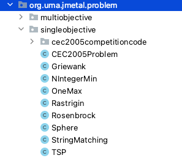
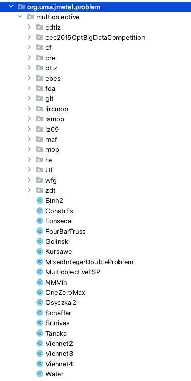

.. _problems:

Problems
========

:Author: Antonio J. Nebro
:Date: 2026-10-05

All the problems in jMetal implement the `Problem <https://github.com/jMetal/jMetal/blob/master/jmetal-core/src/main/java/org/uma/jmetal/problem/Problem.java>`_ interface:

.. code-block:: java

    package org.uma.jmetal.problem;

    /**
     * Interface representing a multi-objective optimization problem
     *
     * @author Antonio J. Nebro
     *
     * @param <S> Encoding
     */
    public interface Problem<S> extends Serializable {
      /* Getters */
      int numberOfVariables() ;
      int numberOfObjectives() ;
      int numberOfConstraints() ;
      String name() ;

      /* Methods */
      void evaluate(S solution) ;
      S createSolution() ;
    }

Every problem is characterized by the number of decision variables, the number of objective functions and the number of constraints, so getter methods for returning those values have to be defined. The genetic type `S` allows to determine the encoding of the solutions of the problem. This way, a problem must include a method for evaluating any solution of class `S` as well as providing a `createSolution()` method for creating a new solution. A class named 
`AbstractGenericProblem <https://github.com/jMetal/jMetal/blob/master/jmetal-core/src/main/java/org/uma/jmetal/problem/AbstractGenericProblem.java>`_ containing setter and getter method implementations for the problem fields is provided.

If a problem has side constraints, it is assumed that the overall constraint degree of a given solution is computed inside the ``evaluate()`` method. The values stored in the ``constraints()`` array of the solutions must follow the jMetal sign convention: a value lower than 0.0 means that the corresponding constraint is violated, and the overall constraint violation degree is the (negative) sum of the values of the violated constraints. Problems whose constraints have non-standard semantics can precompute the number of violated constraints and the overall violation degree as solution attributes by using the setter methods of the ``ConstraintHandling`` utility class (see :ref:`constraints`); in that case, the precomputed degree must be negative for infeasible solutions and 0.0 for feasible ones.

The ``evaluate()`` method must not produce NaN values. The evaluators of jMetal (``SequentialSolutionListEvaluator``, ``MultiThreadedSolutionListEvaluator`` and the ``Evaluation`` components of ``jmetal-component``) check every evaluated solution and throw an ``InvalidConditionException`` naming the problem if an objective, a constraint or a precomputed overall constraint violation degree is NaN: NaN values have no order, so Pareto dominance would keep such solutions silently. Infinite values are accepted. The check is not applied by algorithms that call ``evaluate()`` directly, such as some classic algorithms of ``jmetal-algorithm`` and the asynchronous algorithms of ``jmetal-parallel``.

Among the constrained benchmarks included in ``jmetal-problem``, the ``org.uma.jmetal.problem.multiobjective.cf`` package contains the CF1-CF16 problem suite defined in "Constrained Multiobjective Optimization: Test Problem Construction and Performance Evaluations" (Y. Zhou, Y. Xiang and X. He, IEEE TEVC, 2021), which is scalable in the number of objectives; CF9-CF16 precompute their constraint violation attributes due to their band-type constraints. The reference fronts of these problems (three-objective formulations) are located in the ``resources/referenceFrontsRSG`` directory. The ``org.uma.jmetal.problem.multiobjective.cdtlz`` package provides the C-DTLZ problems (C1_DTLZ1, C1_DTLZ3, C2_DTLZ2, C3_DTLZ1, C3_DTLZ4) proposed in the NSGA-III paper. The ``org.uma.jmetal.problem.multiobjective.dcdtlz`` package provides the DC-DTLZ problems (DC1_DTLZ1, DC1_DTLZ3, DC2_DTLZ1, DC2_DTLZ3, DC3_DTLZ1, DC3_DTLZ3) of the C-TAEA paper (Li et al., IEEE TEVC, 2019), which are scalable in the number of objectives; their constants (a, b and the factor of g) are arguments of the constructors, with the values of the supplementary material of the paper by default, so that the variants of other frameworks can be reproduced. Their reference fronts with two and three objectives are in ``resources/referenceFronts``. The ``org.uma.jmetal.problem.multiobjective.dascmop`` package provides the DAS-CMOP1-9 problems (Fan et al., Evolutionary Computation, 2020), whose constraints are set by a difficulty triplet (eta, zeta, gamma) that controls the diversity-, feasibility- and convergence-hardness, and the ``org.uma.jmetal.problem.multiobjective.mw`` package provides the MW1-MW14 problems (Ma and Wang, IEEE TEVC, 2019). The reference fronts of the C-DTLZ, DAS-CMOP (with their default triplets) and MW problems are in ``resources/referenceFronts``. The ``org.uma.jmetal.problem.multiobjective.mw`` package provides the MW1-MW14 problems (Ma and Wang, IEEE TEVC, 2019), with small feasible regions and the four types of constrained Pareto fronts (from the whole unconstrained front to parts of the boundary of the feasible region); MW4, MW8 and MW14 are scalable in the number of objectives. Their definitions follow the paper (pymoo for MW7-MW14) and differ from PlatEMO in the decision spaces of MW6, MW11, MW13 and MW14, which PlatEMO scales to [0, 1]^n, in the mirrored position variables of MW4 and in the order of the constraints of MW12 and MW13. Their reference fronts are in ``resources/referenceFronts``, with three objectives for MW4, MW8 and MW14 in the ``.3D.csv`` files. The ``org.uma.jmetal.problem.multiobjective.cec2009`` package provides the constrained problems CF1-CF10 of the CEC 2009 competition ("Multiobjective optimization test instances for the CEC 2009 special session and competition", Q. Zhang et al., Technical Report CES-487, 2008) as ``CEC2009CF1``-``CEC2009CF10`` (the unconstrained problems of that competition are in the ``uf`` package, and the ``cf`` package holds the different suite of Zhou, Xiang and He), with 10 variables by default, two objectives (three for CF8-CF10) and one or two constraints. They follow the C code of the competition, and their reference fronts, computed from the Pareto fronts of the report, are in ``resources/referenceFronts`` (``CEC2009CF1.csv`` to ``CEC2009CF10.csv``).

jMetal provides currently the following interfaces representing types of problems (all of them extending ``Problem``), and the available implementations of them:

* `BinaryProblem <https://github.com/jMetal/jMetal/tree/master/jmetal-core/src/main/java/org/uma/jmetal/problem/binaryproblem/BinaryProblem.java>`_

    * `AbstractBinaryProblem <https://github.com/jMetal/jMetal/blob/master/jmetal-core/src/main/java/org/uma/jmetal/problem/binaryproblem/impl/AbstractBinaryProblem.java>`_: Each problem variable is a bit string, and the class includes methods such as ``getBitsFromVariable(int index)`` and ``getTotalNumberOfBits()``.

* `IntegerProblem <https://github.com/jMetal/jMetal/tree/master/jmetal-core/src/main/java/org/uma/jmetal/problem/integerproblem/IntegerProblem.java>`_

    * `AbstractIntegerProblem <https://github.com/jMetal/jMetal/blob/master/jmetal-core/src/main/java/org/uma/jmetal/problem/integerproblem/impl/AbstractIntegerProblem.java>`_: The problem variables are integer values in a given range defined by a lower and upperbound. This means that this class is not adequate for combinatorial problems based on integer values.

* `DoubleProblem <https://github.com/jMetal/jMetal/blob/master/jmetal-core/src/main/java/org/uma/jmetal/problem/doubleproblem/DoubleProblem.java>`_

    * `AbstractDoubleProblem <https://github.com/jMetal/jMetal/blob/master/jmetal-core/src/main/java/org/uma/jmetal/problem/doubleproblem/impl/AbstractDoubleProblem.java>`_: The problem variables are double values in a given range defined by a lower and upperbound.

    * `ComposableDoubleProblem <https://github.com/jMetal/jMetal/blob/master/jmetal-core/src/main/java/org/uma/jmetal/problem/doubleproblem/impl/ComposableDoubleProblem.java>`_: This class allows to define a double problem in a dynamic way, as shown in this code snippet:

    .. code-block:: java

      ComposableDoubleProblem problem = new ComposableDoubleProblem()
      .setName("Srinivas")
      .addVariable(-20.0, 20.0)
      .addVariable(-20.0, 20.0)
      .addFunction((x) -> 2.0 + (x[0] - 2.0) *  (x[0] - 2.0) + (x[1] - 1.0) * (x[1] - 1.0))
      .addFunction((x) -> 9.0 * x[0] - (x[1] - 1.0) * (x[1] - 1.0))
      .addConstraint((x) -> 1.0 - (x[0] * x[0] + x[1] * x[1]) / 225.0)
      .addConstraint((x) -> (3.0 * x[1] - x[0]) / 10.0 - 1.0)) ;

    * `DummyDoubleProblem <https://github.com/jMetal/jMetal/blob/master/jmetal-core/src/main/java/org/uma/jmetal/problem/doubleproblem/impl/DummyDoubleProblem.java>`_: This class is intended to be used in unit testing code (to avoid having to define it many times).

* `PermutationProblem <https://github.com/jMetal/jMetal/tree/master/jmetal-core/src/main/java/org/uma/jmetal/problem/permutationproblem/PermutationProblem.java>`_

    * `AbstractIntegerPermutationProblem <https://github.com/jMetal/jMetal/blob/master/jmetal-core/src/main/java/org/uma/jmetal/problem/permutationproblem/impl/AbstractIntegerPermutationProblem.java>`_: The problem variables are permutations of integer values.

* `SequenceProblem <https://github.com/jMetal/jMetal/tree/master/jmetal-core/src/main/java/org/uma/jmetal/problem/sequenceproblem/SequenceProblem.java>`_

    * `CharSequenceProblem <https://github.com/jMetal/jMetal/blob/master/jmetal-core/src/main/java/org/uma/jmetal/problem/sequenceproblem/impl/CharSequenceProblem.java>`_: The problem variables are sequences of chars.

All the problems provided by jMetal are included in the ``org.uma.jmetal.problem`` package located in the ``jmetal-problem`` sub-project. The package includes the sub-packages ``multiobjective`` and ``singleobjective``, which contains the codes of the problems. You can find both individual
problems (e.g., *Kursawe*, *Sphere*, etc.) and benchmarks suites (such as *ZDT*, *DTLZ* or *LZ09*).

The benchmark suites and problem families of the ``multiobjective`` package (each one in its own sub-package) are:

* *Unconstrained*: ``zdt``, ``dtlz`` (including ``DTLZ1Minus``-``DTLZ4Minus``, the inverted versions used with decomposition-based algorithms), ``wfg``, ``maf`` (MaF1-MaF15, with reference fronts for 3, 5, 10 and 15 objectives in ``resources/referenceFronts``), ``lsmop`` (large-scale), ``lz09``, ``uf`` (CEC2009), ``fda`` (dynamic problems), ``glt``, ``mop``, ``zcat`` and ``cec2015OptBigDataCompetition``.
* *Constrained benchmarks*: ``cf`` (CF1-CF16), ``cec2009`` (CEC2009CF1-CEC2009CF10, the constrained problems of CEC 2009), ``cdtlz`` (C-DTLZ), ``dcdtlz`` (DC-DTLZ), ``dascmop`` (DAS-CMOP1-9), ``mw`` (MW1-MW14) and ``lircmop``.
* *Engineering problems*: ``re`` and ``cre`` (with and without constraints) and ``ebes``.
* *Real-world problems*: ``rwa`` (RWA1-RWA10, box-constrained) and ``cec2021`` (the 50 constrained problems of the RWMOP suite, RCM01-RCM50, from "A Benchmark-Suite of Real-World Constrained Multi-Objective Optimization Problems and some Baseline Results").
* *Combinatorial*: ``multiobjectivetsp`` and ``multiobjectiveknapsack``.

The lists of single- and multi-objective problems are included in the next figures:

